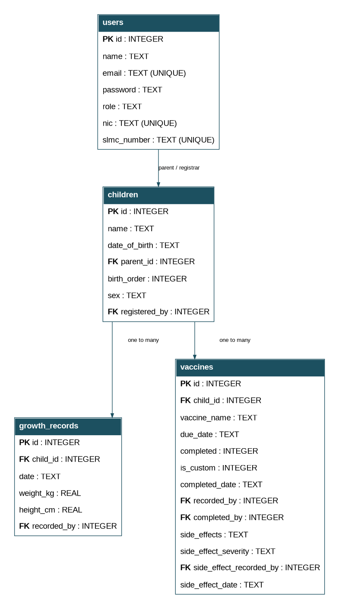
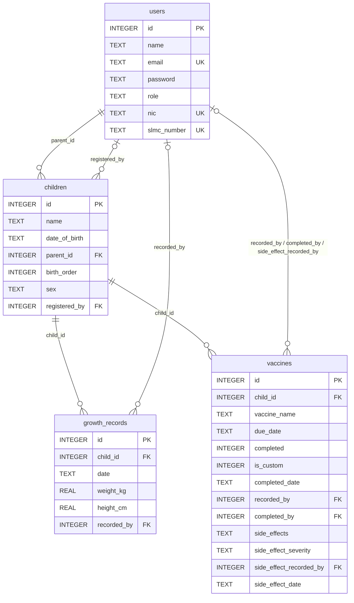

# E-Clinic database ER diagram

The application stores data in four SQLite tables. Each table's `id` is its primary key (`PK`). Linked IDs are foreign keys (`FK`). A health worker is a row in `users` with `role = 'worker'`; a parent has `role = 'parent'`.

## Relationships

- One **parent** can have many children (`children.parent_id` references `users.id`).
- One **child** can have many growth records and many vaccine entries.
- A **health worker** can be associated with children as registrar, with growth records as recorder, and with vaccine entries as recorder/completer/reaction reporter. These worker attribution fields may be empty.
- SQLite stores dates as text in `YYYY-MM-DD` format. Measurements use `REAL` for numeric values.
- Uniqueness is defined on user email, NIC, and SLMC number. The schema contains foreign keys but no automatic cascading deletion rule.
- Custom-vaccine CRUD is limited by application logic to `is_custom = 1` and `completed = 0` for edits/deletions.

**Note:** A `FK` by itself does not guarantee a linked user is a health worker; the application's role checks enforce the workflow. For a future enhancement, role-specific integrity checks could be added at the data layer too.
