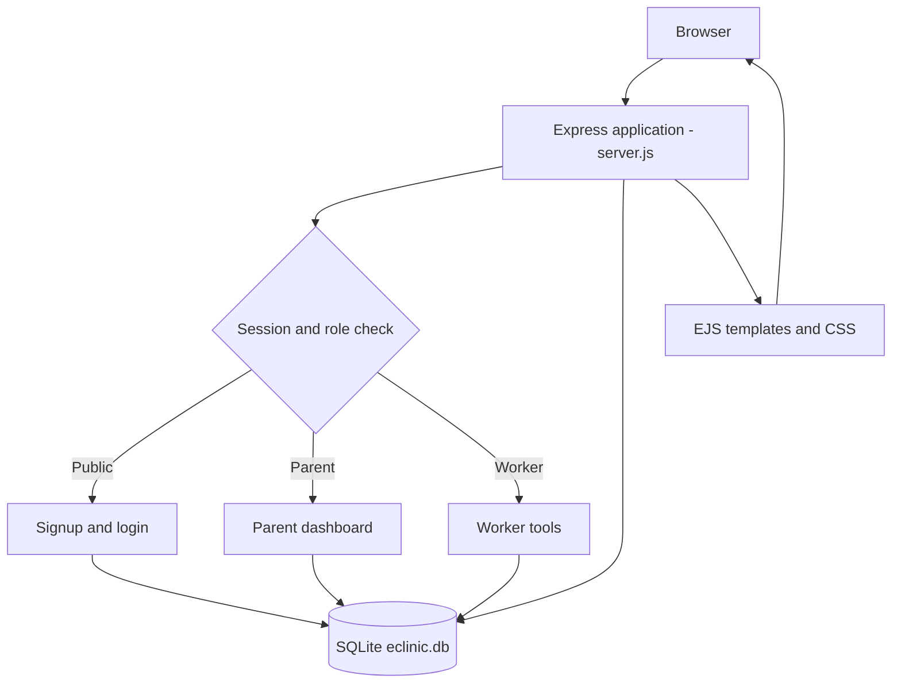

# E-Clinic architecture and request flow

The project uses server-rendered pages rather than a separate API.

## Application modules

| User | Page / flow | Purpose |
| --- | --- | --- |
| Guest | `/signup`, `/login` | Public parent signup and existing-account login |
| Parent | `/dashboard` | View their own children, measurements and vaccine records |
| Worker | `/dashboard` | Open worker tools |
| Worker | `/register-child` | Find parent by NIC, register child and seed vaccine schedule |
| Worker | `/add-growth` | Find child and save weight/height measurements |
| Worker | `/manage-vaccines` | Find child, manage vaccines, report reactions and use name/status filters |

**Request flow:** Browser submits an HTML form with a CSRF token; Express checks the session and role, validates input, uses parameterized SQLite queries, and then renders an EJS page with feedback.

## Important boundaries

- A parent cannot use worker-only pages or write routes.
- Public signup cannot create a worker account.
- Vaccine updates validate that the selected vaccine belongs to the selected child.
- Edits/deletions apply only to pending custom vaccines; standard vaccine schedule records are not deleted through those routes.
- The system is designed as an academic demonstration and is not a clinically validated health-record platform.
